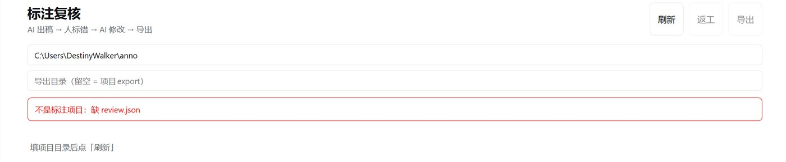
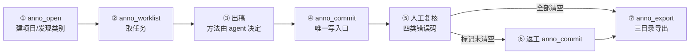

# 杂草标注助手 · dsh-weed-annotation-assistant

标注协作插件：插件只管协议与存档，怎么标注由 agent 现场决定。

> **⚠️ 输出是多边形，不是矩形框。**
> 每株杂草存成 `<polygon>`，而 YOLOv5/v8 等检测框架只读 `<bndbox>`——
> 直接拿去训练会把标注**整批当成背景图**，不报错但全是错的。
> 训练前请自行转换：多边形取外接矩形，或转成分割格式。
> 这是刻意的设计：多边形比外接矩形更贴合叶片，复核界面也依赖它；转换放在训练侧完成。

安装命令：

```
dsh plugin --profile <你的profile> add dsh-weed-annotation-assistant
```

兼容性：**Compatible with: dsh 0.2.x**（桌面端 0.2.1 实测运行；CLI 0.1.0-rc.6 可安装）

[](./LICENSE)
[](https://nodejs.org)
[](https://www.npmjs.com/package/dsh-weed-annotation-assistant)

An annotation **collaboration protocol** for DSH. The plugin owns the data contract,
storage, visual review and export; the agent decides *how* to annotate —
classic CV, a detector, a multimodal model, or manual work. No model is bundled.

---

## 吃什么 · 吐什么

**输入**——三样东西，都在你本地：

```
images\     待标注图片，jpg / png / bmp / webp              （必需）
refs\       每个杂草种类一个子文件夹 + 一份写明各标签英文名的文档（必需，格式任意）
labeled\    你已有的手工标注，Pascal VOC                    （可选）
```

**输出**——Pascal VOC，可直接进训练流程：

```
<导出目录>\
├─ Annotations\   没出错的标注：每株杂草一个多边形 + 英文类别名
├─ JPEGImages\    全部原图
├─ flagged\       被人工标错的图（其 XML 不导出，避免污染训练集）
└─ report.json    总数、各类数量、错因清单
```

一句话：**给三个文件夹，拿一套干净的 VOC 数据集**。类别完全由你的参考图 + 标签文档决定，插件不内置任何物种。

---

## 为什么不是"又一个标注工具"

传统标注工具把"怎么标"焊死在代码里，换物种、换拍摄方式就要改代码；
纯手工又慢。本项目把两者拆开：

```
人 ──说话──> AI（决定怎么标）──anno_commit──> 插件（存 + 复核 + 导出）──标记──> AI（改）
```

- **算法可换**：插件不依赖任何检测/分割模型，方法在 agent 手里
- **数据可迁移**：类别从参考图目录自动发现，换物种不改代码
- **错误可回流**：人工只需点出"哪里错、错成什么"，不逐张重画
- **结果可交付**：导出时自动分离"干净标签 / 全部原图 / 待人工原图"

## 界面


**这个面板不能自己发起标注**——它只是"看和挑错"的地方。所有标注都必须由对话里的 AI
通过 `anno_*` 工具完成；项目还没建（缺 `review.json`）时打开就是一屏报错：



所以正确顺序永远是：**先在对话里让 AI 建项目并出稿 → 侧栏才会长出图，再去挑错。**

### 每个控件干什么

| 控件 | 作用 |
|---|---|
| **刷新** | 重新读项目；AI 提交后界面也会 3 秒内自动刷新 |
| **返工** | 把当前所有标记整理成一句话，复制后粘到对话里交给 AI |
| **导出** | 调 `anno_export`，产出 `Annotations/` `JPEGImages/` `flagged/` 三目录 |
| 项目目录输入框 | 当前项目路径（即 `anno_open` 的 `out`），可手改后点刷新 |
| 导出目录输入框 | 留空 = `<项目>/export`；填了就用你指定的位置 |
| 统计行 | 总计 / 已标 / 空标注 / 未标 / 待处理 |
| **快速选择** | 勾上后：先点错误类型，再点图片即标记（下面的四个按钮） |
| **类别错 / 框偏移 / 漏标 / 该空** | 四种错误码；选中一种后点图打标，换类型再点＝改标记，同类型重复点＝取消 |
| 目标类别下拉 | 配合「类别错」使用：直接指定这张图**应该是**哪个类 |
| 类别筛选条（全部 / 各类 n） | 只看某一类；括号是数量 |
| 搜索文件名 | 按文件名过滤 |
| **只看标记 / 只看空 / 低置信** | 只看被标错的 / 只看空标注的 / 只看 AI 置信度低的 |
| 缩略图右上「标错」 | 单张标记（不开快速选择时用） |
| 缩略图上的多边形 | 红色 = 某类杂草；点图可放大看细节 |

## 安装

**命令行**（推荐，已实测）：

```powershell
dsh plugin --profile <你的profile> add dsh-weed-annotation-assistant
```

桌面客户端的 profile 固定是 `desktop`：

```powershell
dsh plugin --profile desktop add dsh-weed-annotation-assistant
```

装完重启 DSH：侧栏出现「标注复核」，对话中可直接调用 `anno_*` 工具。

> 需要 dsh 0.2.x。安装后依赖记为 `^1.x`，之后的补丁版本会自动跟上。

**离线安装**：从 [Releases](https://github.com/destinywalker2025-design/dsh-weed-annotation-assistant/releases) 下载 `dsh-weed-annotation-assistant-1.0.1.tgz`，然后：

```powershell
dsh plugin --profile desktop add <tgz 的绝对路径>
```

**插件市场**：尚未收录，目前请用上面的命令行方式。

## 输入

插件只认用户给的三样东西，**不内置任何物种**：

```
D:\data\
├─ images\              待标注图片                    （必需）
├─ refs\                每个杂草种类一个子文件夹      （必需）
│   ├─ 稗草1\   ……该类样例图
│   ├─ 马齿苋\
│   └─ labels.md       说明各子文件夹的英文标签名（任意格式，AI 读）
└─ labeled\             已有手工标注（Pascal VOC）    （可选）
```

标签文档写什么、什么格式都行，例如：

```
稗草1   → barnyard_grass
马齿苋  → purslane
```

AI 读完后会把 `{子文件夹: 英文名}` 作为 `classMap` 传给插件。缺目录、缺文档时
`anno_open` 会直接报错说明缺什么，AI 会转述给你补齐。

**图片格式**：`jpg` / `jpeg` / `png` / `bmp` / `webp`，文件名随意（会按字典序处理），
子目录里的图片不会被展开——请把待标注图片平铺在 `images\` 下。

**典型规模参考**：单批 1000～2000 张、每张 1～5 株杂草都跑得动；
参考图每类 3～20 张即可，只用来给 AI 认样子，不参与训练。

## 快速开始

```
你：帮我标注这批图，图片在 D:\data\images，参考图在 D:\data\refs，输出到 D:\data\out

AI：anno_open(images=..., refs=..., out=..., classMap={...})
    → 校验输入、建项目、返回类别与待标数量
AI：anno_worklist(out, filter="unlabeled")
    → 分批取文件（可调 anno_baseline 先出一版便宜初稿）
AI：anno_commit(out, items=[{file, class, polygon, method:"ai"}])
    → 唯一写入口

你：侧栏「标注复核」翻一遍，把错的标红

AI：anno_review(out) → 按四类拿到标记 → anno_commit 修正
你：刷新 → 红框消失
AI：anno_export(out) → 三个目录
```

## 工具

| 工具 | 关键参数 | 作用 |
|---|---|---|
| `anno_open` | `images` `out` `refs` `labeled?` `classMap?` `classes?` `fresh?` | 校验输入、建项目、确定类别 |
| `anno_worklist` | `out` `filter?` `cursor?` `limit?` | 待处理文件（unlabeled / flagged / low-confidence / all） |
| `anno_commit` | `out` `items[]` `allowNewClasses?` | **唯一写入口**：标注、只改类别、只改框、确认 |
| `anno_review` | `out` | 进度 + 类别分布 + 标记（四类聚合） |
| `anno_export` | `out` `split?` `dir?` | 三目录导出 + `report.json` |
| `anno_baseline` | `out` `limit?` | 可选：跑附带的经典 CV 基线（类别由项目传入） |

```jsonc
// anno_commit 的一条结果
{ "file": "image001.jpg",
  "class": "purslane",
  "polygon": [[15,144],[217,161],[197,372],[0,353]],  // 或 "bbox": [x1,y1,x2,y2]
  "empty": false,          // true = 只有作物，写空 XML
  "confidence": 0.82,
  "method": "baseline"     // baseline | ai | human | 自定义
}
```

## 输出格式

> ⚠️ **本节描述的几何是 `<polygon>` 多边形，不是训练框架默认吃的 `<bndbox>` 矩形框。**
> 拿去训练前必须自己转（见开头的重要声明）。

### 项目内部（`<out>/`，随时可重建）

```
<out>/
├─ JPEGImages/     原图硬链接（失败退回复制）
├─ Annotations/    Pascal VOC XML，每条结果一个文件
├─ review.json     唯一真源：类别、多边形、来源、置信度
├─ flags.json      人工标记：四类错误码 + 正确类别 + 备注
└─ project.json    建项目时的参数（images / refs / labeled / classMap …）
```

`Annotations/*.xml` 是派生物，改 `review.json` 后随时重建；被标错的图，
其 XML 会立刻从 `Annotations/` 消失。

### 单条标注（Pascal VOC）

```xml
<annotation>
  <folder>JPEGImages</folder>
  <filename>image0001.jpg</filename>
  <size><width>1920</width><height>1080</height><depth>3</depth></size>
  <object>
    <name>barnyard_grass</name>        <!-- 你给的英文标签 -->
    <pose>Unspecified</pose>
    <truncated>0</truncated>
    <difficult>0</difficult>
    <polygon>
      <x1>312</x1><y1>204</y1>
      <x2>498</x2><y2>212</y2>
      <x3>505</x3><y3>431</y3>
      <x4>318</x4><y4>420</y4>
    </polygon>
  </object>
</annotation>
```

- 一个 `<object>` = 一株杂草；多边形至少 3 点
- 只有作物、没有杂草的图 → 写**空 XML**（没有任何 `<object>`），不算漏标
- 类别名完全来自你给的 `classMap`，插件不翻译、不猜

### 交付目录（`anno_export` 产出）

```
<导出目录>/
├─ Annotations/   只含「未被标记为错误」的图的 XML
├─ JPEGImages/    全部原图
├─ flagged/       被标记为错误的那部分原图（其 XML 不导出）
└─ report.json    计数 + 标记清单
```

**硬规则**：被标记的图，标签绝不进入 `Annotations/`，从流程上避免错误标签混入训练集。

## 数据契约

插件的全部状态是输出目录里的两份 JSON：

| 文件 | 角色 |
|---|---|
| `review.json` | 唯一真源：每条结果的类别、多边形、来源、置信度 |
| `flags.json` | 人工标记：四类错误码 + 正确类别 + 备注 |

`Annotations/*.xml` 由 `review.json` **派生**，任何一次提交都能完整重建。
完整字段与状态机见 [`docs/SPEC.md`](docs/SPEC.md)。

## 协议流程



## 目录结构

```
anno-agent/
├─ index.js            Host 半：项目存档 + 6 个工具 + HTTP
├─ client.js           复核页（React，无构建）
├─ cordis.patch.yml    插件注册
├─ docs/SPEC.md        数据契约（权威）
├─ docs/assets/        README 配图
├─ locale/             中英文案
└─ tools/baseline.py   可选：经典 CV 基线
```

## 依赖

- DSH 桌面版 / Web UI（需 `tools`、`webServer` 服务）
- 可选：Python 3.10+ 与 `opencv-python`、`numpy`，**仅** `anno_baseline` 需要；
  不装也能用，插件会提示直接 `anno_commit`。解释器可用 `ANNO_PYTHON` 指定。

## 开发

```powershell
# 本地联调：插件管理 → 安装 → 填本目录绝对路径（link 方式）
npm pack                      # 打离线包
npm publish --access public   # 发布到 npm（需 npm login）
```

## 已知限制

- ⚠️ **标注是多边形，不是标准矩形框**：YOLOv5/v8 等检测框架只读 `<bndbox>`，
  直接训练会静默失效，**必须自行转换**（见开头「重要」）。
- 插件**不做物种识别**：每类的英文标签名必须由你在 `refs` 的标签文档里给出，
  插件只负责把文档里的名字落到 XML 上；换物种＝换输入目录，不改代码。
- 插件**不提高**单张图像的标注精度：初稿精度取决于所采用的标注方法，
  插件保证的是流程可追溯、结果一致、错误可回流。
- **界面不能发起标注**：侧栏只能看和挑错，建项目/出稿/修正都得由对话里的 AI 调工具完成。
- 复核页不含多边形绘制工具：`漏标` 类问题需要 agent 重新定位，
  仍无法解决时会在 `flagged/` 中原样交回人工。

## License

[MIT](./LICENSE)
