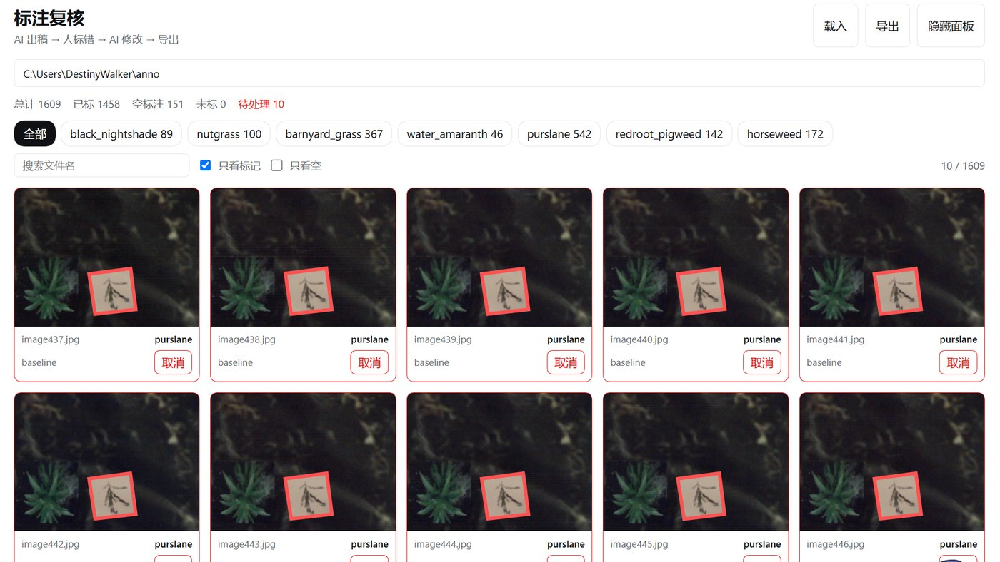
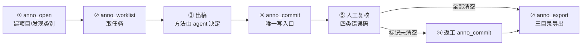

# 杂草标注助手 · dsh-weed-annotation-assistant

标注协作插件：插件只管协议与存档，怎么标注由 agent 现场决定。
安装命令：

```
dsh plugin --profile <你的profile> add dsh-weed-annotation-assistant
```

兼容性：**Compatible with: dsh 0.2.x**（桌面端 0.2.1 实测运行；CLI 0.1.0-rc.6 可安装）

[](./LICENSE)
[](https://nodejs.org)
[](https://www.npmjs.com/package/dsh-weed-annotation-assistant)

An annotation **collaboration protocol** for DSH. The plugin owns the data contract,
storage, visual review and export; the agent decides *how* to annotate —
classic CV, a detector, a multimodal model, or manual work. No model is bundled.

---

## 为什么不是"又一个标注工具"

传统标注工具把"怎么标"焊死在代码里，换物种、换拍摄方式就要改代码；
纯手工又慢。本项目把两者拆开：

```
人 ──说话──> AI（决定怎么标）──anno_commit──> 插件（存 + 复核 + 导出）──标记──> AI（改）
```

- **算法可换**：插件不依赖任何检测/分割模型，方法在 agent 手里
- **数据可迁移**：类别从参考图目录自动发现，换物种不改代码
- **错误可回流**：人工只需点出"哪里错、错成什么"，不逐张重画
- **结果可交付**：导出时自动分离"干净标签 / 全部原图 / 待人工原图"

## 界面



- 缩略图叠加多边形，可按类别、低置信、仅看待处理筛选
- **快速选择**：先选错误类型（类别错 / 框偏移 / 漏标 / 该空），再点图即标记；
  换类型再点 = 改标记，同类型重复点 = 取消
- **返工**：一键把当前标记整理成一句话，粘到对话里交给 AI
- 数据变化后 3 秒内自动刷新

## 安装

**DSH 插件市场**：设置 → 插件 → 搜索 `weed-annotation-assistant`

**npm**（在插件管理的安装源里填）：

```
dsh-weed-annotation-assistant
```

**离线包**：`npm pack` 产出的 `.tgz`，在插件管理里从文件安装。

## 快速开始

```
你：帮我标注这批图，图片在 D:\data\images，参考图在 D:\data\refs，输出到 D:\data\out

AI：anno_open(images=..., refs=..., out=...)
    → 发现类别、建项目、返回待标数量
AI：anno_worklist(out, filter="unlabeled")
    → 分批取文件（可调 anno_baseline 先出一版便宜初稿）
AI：anno_commit(out, items=[{file, class, polygon, method:"ai"}])
    → 唯一写入口

你：侧栏「标注复核」翻一遍，把错的标红

AI：anno_review(out) → 按四类拿到标记 → anno_commit 修正
你：刷新 → 红框消失
AI：anno_export(out) → 三个目录
```

## 工具

| 工具 | 关键参数 | 作用 |
|---|---|---|
| `anno_open` | `images` `out` `refs?` `train?` `classes?` `fresh?` | 建项目：链接图片、发现类别 |
| `anno_worklist` | `out` `filter?` `cursor?` `limit?` | 待处理文件（unlabeled / flagged / low-confidence / all） |
| `anno_commit` | `out` `items[]` `allowNewClasses?` | **唯一写入口**：标注、只改类别、只改框、确认 |
| `anno_review` | `out` | 进度 + 类别分布 + 标记（四类聚合） |
| `anno_export` | `out` `split?` `dir?` | 三目录导出 + `report.json` |
| `anno_baseline` | `out` `limit?` | 可选：跑附带的经典 CV 基线 |

```jsonc
// anno_commit 的一条结果
{ "file": "image001.jpg",
  "class": "purslane",
  "polygon": [[15,144],[217,161],[197,372],[0,353]],  // 或 "bbox": [x1,y1,x2,y2]
  "empty": false,          // true = 只有作物，写空 XML
  "confidence": 0.82,
  "method": "baseline"     // baseline | ai | human | 自定义
}
```

## 导出结构

```
<导出目录>/
├─ Annotations/   只含「未被标记为错误」的图的 XML
├─ JPEGImages/    全部原图
├─ flagged/       被标记为错误的那部分原图（其 XML 不导出）
└─ report.json    计数 + 标记清单
```

**硬规则**：被标记的图，标签绝不进入 `Annotations/`，从流程上避免错误标签混入训练集。

## 数据契约

插件的全部状态是输出目录里的两份 JSON：

| 文件 | 角色 |
|---|---|
| `review.json` | 唯一真源：每条结果的类别、多边形、来源、置信度 |
| `flags.json` | 人工标记：四类错误码 + 正确类别 + 备注 |

`Annotations/*.xml` 由 `review.json` **派生**，任何一次提交都能完整重建。
完整字段与状态机见 [`docs/SPEC.md`](docs/SPEC.md)。

## 协议流程



## 目录结构

```
anno-agent/
├─ index.js            Host 半：项目存档 + 6 个工具 + HTTP
├─ client.js           复核页（React，无构建）
├─ cordis.patch.yml    插件注册
├─ docs/SPEC.md        数据契约（权威）
├─ docs/assets/        README 配图
├─ locale/             中英文案
└─ tools/baseline.py   可选：经典 CV 基线
```

## 依赖

- DSH 桌面版 / Web UI（需 `tools`、`webServer` 服务）
- 可选：Python 3.10+ 与 `opencv-python`、`numpy`，**仅** `anno_baseline` 需要；
  不装也能用，插件会提示直接 `anno_commit`。解释器可用 `ANNO_PYTHON` 指定。

## 开发

```powershell
# 本地联调：插件管理 → 安装 → 填本目录绝对路径（link 方式）
npm pack                      # 打离线包
npm publish --access public   # 发布到 npm（需 npm login）
```

## 已知限制

- 插件**不提高**单张图像的标注精度：初稿精度取决于所采用的标注方法，
  插件保证的是流程可追溯、结果一致、错误可回流。
- 复核页不含多边形绘制工具：`漏标` 类问题需要 agent 重新定位，
  仍无法解决时会在 `flagged/` 中原样交回人工。

## License

[MIT](./LICENSE)
